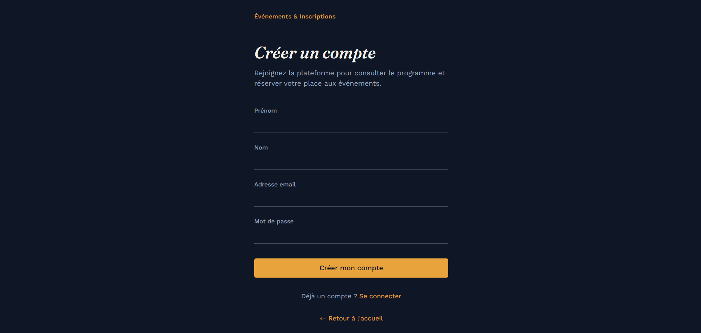
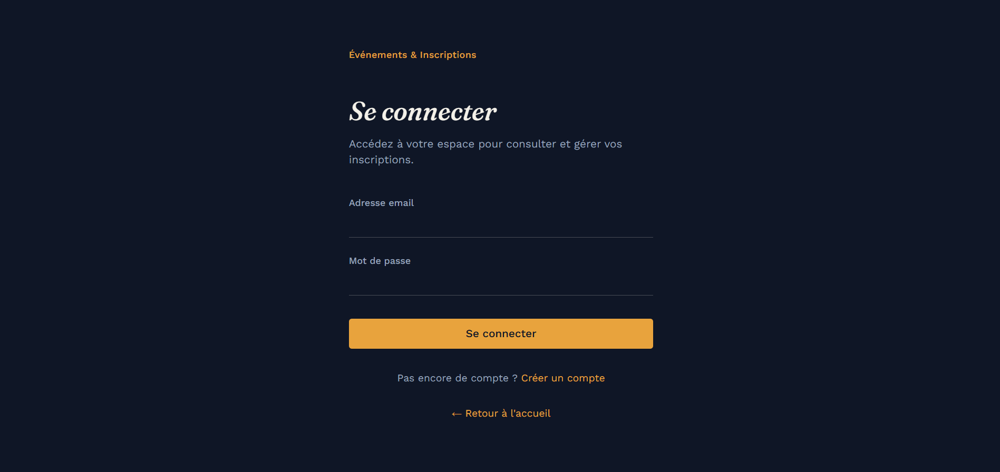
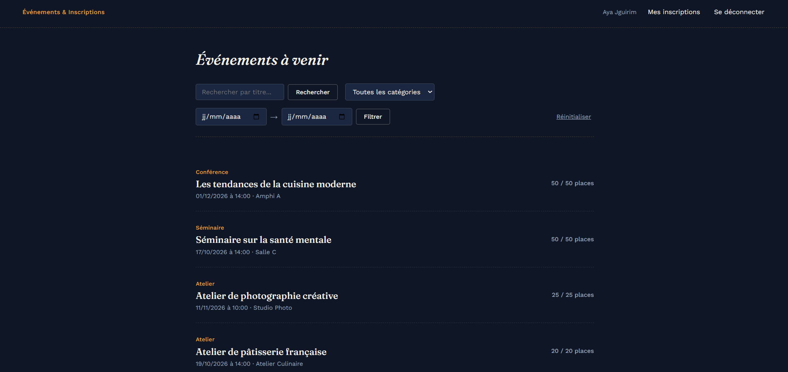
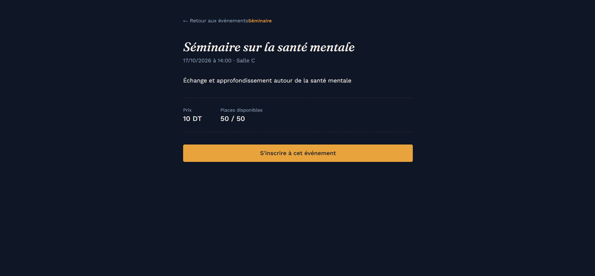
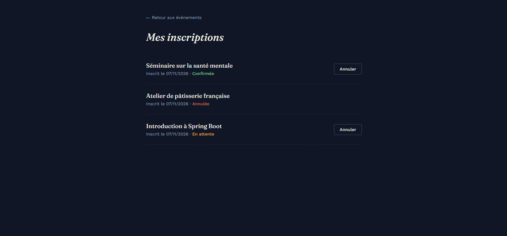
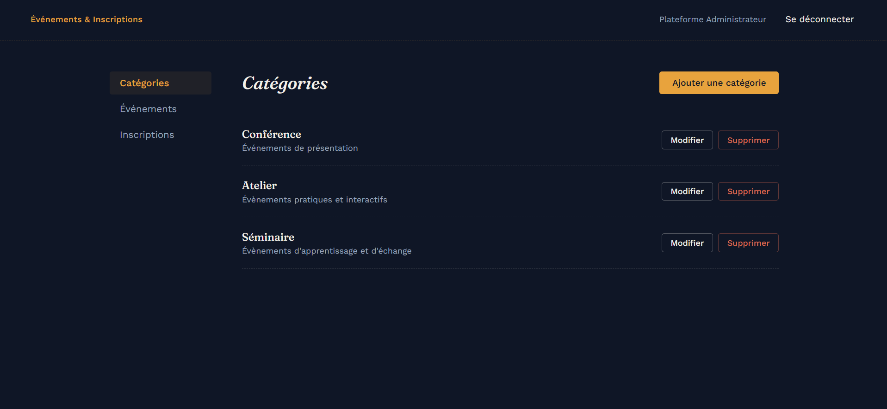
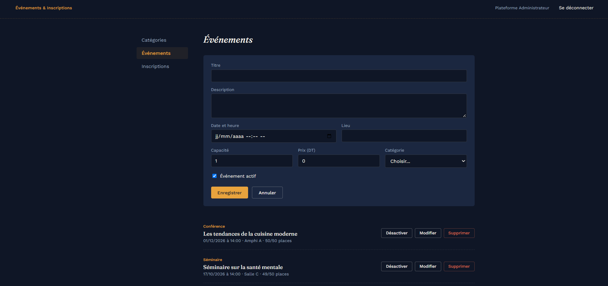
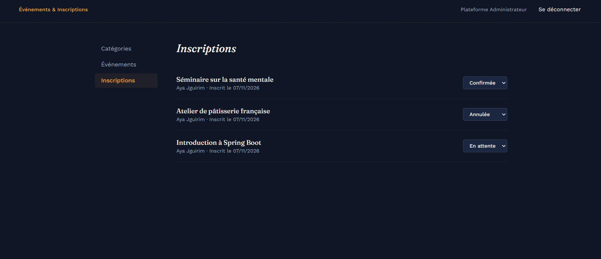
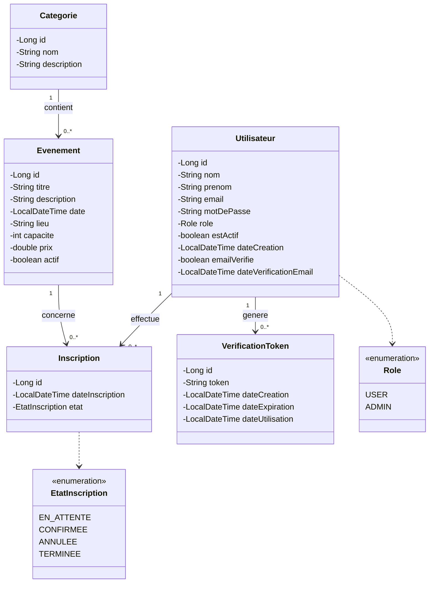
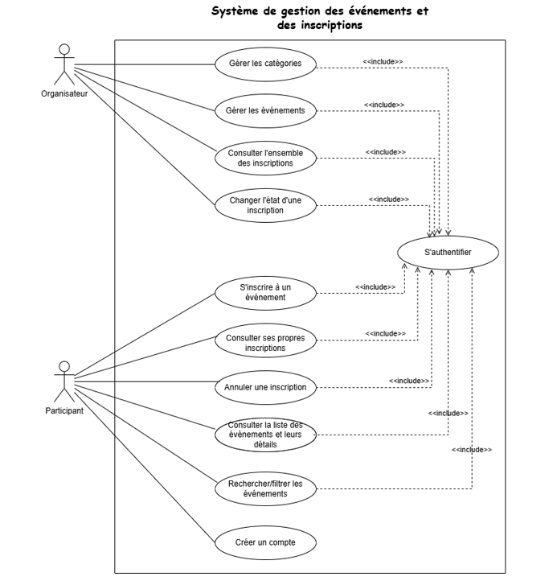

# Event Management Platform

A full-stack web application that centralizes event management and participant registration, replacing manual processes based on spreadsheets, forms, and messaging.

Participants discover events, register while places remain, and manage their own registrations. Administrators manage categories, events, and every registration through a dedicated administration area.


## Table of Contents

- [Event Management Platform](#event-management-platform)
  - [Table of Contents](#table-of-contents)
  - [Overview](#overview)
  - [Features](#features)
    - [Authentication and Account Management](#authentication-and-account-management)
    - [Participant Area](#participant-area)
    - [Administration Area](#administration-area)
    - [Business Rules](#business-rules)
    - [Registration Workflow](#registration-workflow)
  - [User Roles](#user-roles)
  - [Technology Stack](#technology-stack)
    - [Frontend](#frontend)
    - [Backend](#backend)
    - [Database](#database)
    - [Tools](#tools)
  - [Architecture](#architecture)
    - [Error Handling](#error-handling)
  - [Database](#database-1)
    - [Use Case Diagram](#use-case-diagram)
  - [API Overview](#api-overview)
  - [Installation and Setup](#installation-and-setup)
    - [Prerequisites](#prerequisites)
    - [1. Clone the repository](#1-clone-the-repository)
    - [2. Prepare the database](#2-prepare-the-database)
    - [3. Configure and run the backend](#3-configure-and-run-the-backend)
    - [4. Run the frontend](#4-run-the-frontend)
    - [5. First use](#5-first-use)
  - [Security](#security)
  - [Testing](#testing)
  - [Project Structure](#project-structure)
  - [Possible Improvements](#possible-improvements)
  - [Author](#author)

## Overview

Organizing workshops, seminars, and conferences by hand quickly becomes hard to follow: nobody knows how many places remain, duplicate registrations appear, and event information is scattered across files.

This platform provides one place to publish events, track available places in real time, and follow the status of every registration. The frontend (Angular) communicates with a REST API (Spring Boot) backed by a MySQL database.

## Features

### Authentication and Account Management

- Account registration with validation on both frontend and backend.
- Email verification: a verification link is sent by email, and login is refused until the address is verified.
- Resending of the verification email.
- JWT-based authentication and role-based authorization (`USER`, `ADMIN`).

| Registration | Login |
|---|---|
|  |  |

### Participant Area

- Browse events with title, category, date, place, capacity, and **remaining places**.
- Search by title, filter by category, and filter by date range.
- View detailed information about an event.
- Register for an event while places are available.
- View personal registrations and cancel them when allowed.







### Administration Area

- Create, update, and delete categories.
- Create, update, activate, deactivate, and delete events.
- View all registrations with the participant, the event, and the registration date.
- Change the status of a registration.







### Business Rules

| Rule | Description |
|---|---|
| RG1 | A participant cannot hold two active registrations for the same event. |
| RG2 | A registration is refused once the event capacity is reached. |
| RG3 | A category cannot be deleted while an event uses it. |
| RG4 | An event that already has registrations cannot be deleted; it can be deactivated. |
| RG5 | Email verification is required before the first login. |
| RG6 | Access is controlled by role on both the frontend (guards) and the backend (Spring Security). |
| RG7 | Registration status changes follow a defined workflow. |

### Registration Workflow

| Current status | Allowed next statuses |
|---|---|
| `EN_ATTENTE` | `CONFIRMEE`, `ANNULEE` |
| `CONFIRMEE` | `TERMINEE`, `ANNULEE` |
| `ANNULEE` | none |
| `TERMINEE` | none |

A participant can only cancel their own registrations. Only an administrator can change a status freely within the workflow above.

## User Roles

| Role | Permissions |
|---|---|
| `USER` (participant) | Browse events, register, view and cancel their own registrations. |
| `ADMIN` (organizer) | Manage categories, events, users, and all registrations. |

Public pages: landing page, registration, login, and email verification. Every other page requires authentication.

## Technology Stack

### Frontend
- Angular (standalone components, signals, Reactive Forms, Router)
- TypeScript
- HTML and SCSS
- HTTP interceptor (JWT) and route guards

### Backend
- Java 21
- Spring Boot 4.1.1
- Spring Web (REST API)
- Spring Data JPA / Hibernate
- Spring Security with OAuth2 Resource Server (JWT)
- Jakarta Bean Validation
- Spring Mail
- Maven

### Database
- MySQL

### Tools
- Visual Studio Code, IntelliJ IDEA
- Postman
- Git and GitHub

## Architecture

The application follows a three-tier client-server architecture.

```text
┌──────────────────┐   HTTP / JSON   ┌───────────────────┐   JDBC   ┌─────────┐
│ Angular (SPA)    │ ──────────────▶ │ Spring Boot API   │ ───────▶ │ MySQL   │
│ localhost:4200   │ ◀────────────── │ localhost:8082    │ ◀─────── │         │
└──────────────────┘   JWT header    └───────────────────┘          └─────────┘
```

**Backend layers**

- `controller`: REST endpoints
- `service`: business logic and business rules
- `repository`: Spring Data JPA repositories
- `entity`: JPA entities
- `dto` and `mapper`: request/response objects and conversions (entities are never exposed directly)
- `security`: JWT generation, user details loading
- `config`: security, JWT, and CORS configuration, administrator initialization
- `exception`: centralized exception handling with structured JSON errors

**Frontend organization**

- Feature components (`accueil`, `register`, `login`, `verify-email`, `evenements`, `evenement-detail`, `mes-inscriptions`, `admin`, `admin-categories`, `admin-evenements`, `admin-inscriptions`)
- `services`: HTTP services and authentication state (signals)
- `models`: TypeScript interfaces matching the backend DTOs
- `guards`: `authGuard` and `adminGuard`
- `interceptors`: automatic `Authorization: Bearer <token>` header

### Error Handling

The backend returns structured JSON errors, with per-field messages for validation failures:

```json
{
  "timestamp": "2026-09-08T10:30:00",
  "statut": 400,
  "message": "Des erreurs de validation ont été détectées",
  "erreursChamps": {
    "email": "Le format de l'email est invalide"
  }
}
```

## Database

Main entities:

- **Utilisateur**: account information, role, and email verification status.
- **Categorie**: event categories.
- **Evenement**: event information, capacity, price, and activation status.
- **Inscription**: a participant's registration to an event, with its status.
- **VerificationToken**: email verification tokens with expiration and usage tracking.

Tables are created and updated automatically by Hibernate on startup (`ddl-auto=update`).



### Use Case Diagram



## API Overview

Base URL: `http://localhost:8082`

| Area | Endpoints | Access |
|---|---|---|
| Authentication | `POST /api/auth/register`, `POST /api/auth/login`, `GET /api/auth/verify-email?token=`, `POST /api/auth/resend-verification` | Public |
| Categories | `GET /api/categories`, `GET /api/categories/{id}` | Authenticated |
| Categories | `POST`, `PUT /{id}`, `DELETE /{id}` on `/api/categories` | `ADMIN` |
| Events | `GET /api/evenements`, `/{id}`, `/recherche?titre=`, `/categorie/{id}`, `/date?debut=&fin=` | Authenticated |
| Events | `POST`, `PUT /{id}`, `DELETE /{id}` on `/api/evenements` | `ADMIN` |
| Registrations | `POST /api/inscriptions`, `GET /api/inscriptions/mes-inscriptions`, `PUT /api/inscriptions/{id}/annuler` | Authenticated (own data only) |
| Registrations | `GET /api/inscriptions`, `GET /api/inscriptions/{id}`, `PUT /api/inscriptions/{id}/etat` | `ADMIN` |
| Users | `/api/utilisateurs/**` | `ADMIN` |

The full endpoint reference, with request and response examples, is available in [`docs/API-README.md`](docs/API-README.md).

## Installation and Setup

### Prerequisites

- Java 21
- Maven
- Node.js and npm
- Angular CLI
- MySQL
- Git

### 1. Clone the repository

```bash
git clone https://github.com/AyaJguirim/Event-Management-Platform.git
cd Event-Management-Platform
```

### 2. Prepare the database

Start your MySQL server. The database is created automatically on the first run if the connection URL contains `createDatabaseIfNotExist=true`.

### 3. Configure and run the backend

Private settings are kept in a local file that is **not** committed to Git.

Create `projet-backend/application-secret.properties`:

```properties
DB_URL=jdbc:mysql://localhost:3306/event_management?createDatabaseIfNotExist=true
DB_USERNAME=your_database_username
DB_PASSWORD=your_database_password

JWT_SECRET=your_base64_encoded_secret_of_at_least_32_bytes

ADMIN_EMAIL=admin@example.com
ADMIN_PASSWORD=your_admin_password

MAIL_USERNAME=your_gmail_address@gmail.com
MAIL_PASSWORD=your_google_app_password
MAIL_FROM=your_gmail_address@gmail.com

VERIFICATION_BASE_URL=http://localhost:4200/verify-email
```

Important details:

- `JWT_SECRET` must be a **Base64-encoded value of at least 32 bytes**. Generate one with:
  - PowerShell: `[Convert]::ToBase64String((1..32 | ForEach-Object { Get-Random -Maximum 256 }))`
  - Linux/macOS: `openssl rand -base64 32`
- `MAIL_FROM` must be a **valid email address**, not a display name.
- `MAIL_PASSWORD` is a Google *app password* (requires 2-step verification on the Google account), not the regular account password.
- `VERIFICATION_BASE_URL` must include the `/verify-email` path: the backend appends `?token=...` to it.

Run the backend:

```bash
cd projet-backend
mvn spring-boot:run
```

The API starts on `http://localhost:8082`. On the first run, an administrator account is created automatically from `ADMIN_EMAIL` and `ADMIN_PASSWORD`, with its email already verified.

### 4. Run the frontend

In another terminal:

```bash
cd projet-frontend
npm install
ng serve
```

The application is available at `http://localhost:4200`.

The frontend calls the backend at `http://localhost:8082` (defined in the Angular services), and the backend allows CORS requests from `http://localhost:4200`.

### 5. First use

1. Open `http://localhost:4200`.
2. Create a participant account and open the verification link received by email.
3. Log in as a participant to browse events, or log in with the administrator credentials to open the administration area.

## Security

- Passwords are hashed with BCrypt.
- Stateless authentication with signed JWT (HS256), stored in `sessionStorage` on the client and sent automatically by an HTTP interceptor.
- Role-based access control enforced twice: by Angular route guards and by Spring Security on every endpoint.
- Participants can only read and cancel their own registrations; the user identity always comes from the token, never from the request.
- Login is refused until the email address is verified.
- Validation on both frontend (Reactive Forms) and backend (Jakarta Validation).
- CORS restricted to the frontend origin.
- Secrets (database, JWT, mail, administrator credentials) live in `application-secret.properties`, which is excluded by `.gitignore`.

**Never commit real credentials.** If a secret was ever committed by mistake, revoke it and generate a new one: deleting it from a later commit does not remove it from the Git history.

## Testing

A complete Postman test plan (registration, email verification, login, categories, events, registrations, roles, and every business rule RG1 to RG7) is available in [`docs/Plan-de-tests-Postman.md`](docs/Plan-de-tests-Postman.md).

## Project Structure

```text
Event-Management-Platform/
│
├── docs/
│   ├── API-README.md
│   ├── Plan-de-tests-Postman.md
│   ├── diagrams/
│   │   └── use-case-diagram.png
│   └── screenshots/
│
├── projet-backend/
│   ├── src/main/java/com/example/projetbackend/
│   │   ├── config/
│   │   ├── controller/
│   │   ├── dto/
│   │   ├── entity/
│   │   ├── exception/
│   │   ├── mapper/
│   │   ├── repository/
│   │   ├── security/
│   │   └── service/
│   ├── src/main/resources/
│   │   └── application.properties
│   └── pom.xml
│
├── projet-frontend/
│   ├── src/app/
│   │   ├── accueil/ register/ login/ verify-email/
│   │   ├── evenements/ evenement-detail/ mes-inscriptions/
│   │   ├── admin/ admin-categories/ admin-evenements/ admin-inscriptions/
│   │   ├── models/ services/ guards/ interceptors/
│   │   └── app.routes.ts
│   ├── angular.json
│   └── package.json
│
└── README.md
```

## Possible Improvements

- Upload of event images.
- Pagination on event and registration lists.
- Email notification when a registration status changes.
- Environment-based API URL in the Angular app instead of a hardcoded address.
- Automated tests (unit and integration).

## Author

**Aya Jguirim**

Decision-making computing Student, Business Intelligence

GitHub: [AyaJguirim](https://github.com/AyaJguirim)

---

*Academic project: Event Management Platform.*
